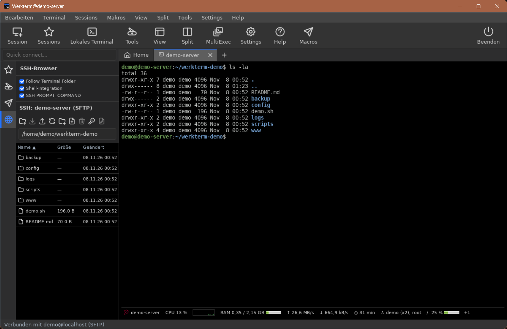
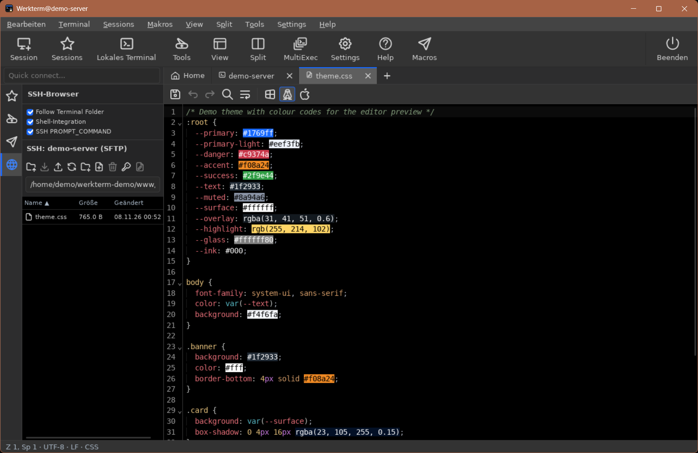
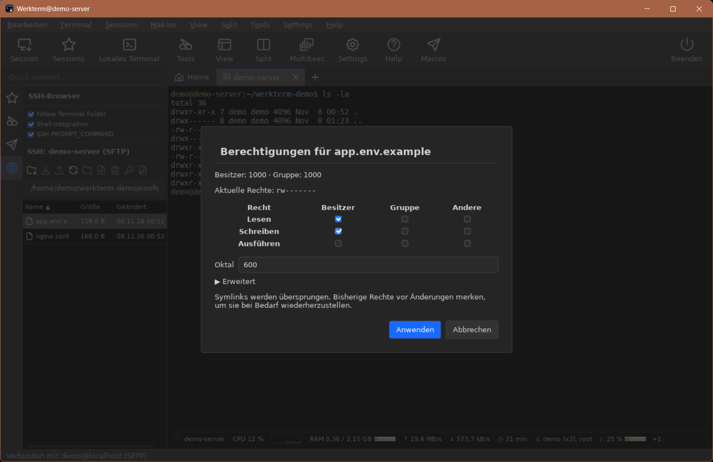

# Werkterm – SSH-Terminal mit SFTP-Browser und Editor für Linux und Windows

English version: [README.md](README.md)

Werkterm ist eine Desktop-Anwendung mit Tauri 2, Rust und React. Sie bietet lokale Terminals, SSH mit einem SFTP-Browser, der dem Terminal-Verzeichnis folgt, und einen integrierten Editor. Zielplattformen sind Linux (vorrangig) und Windows 10/11 x64.

> [!NOTE]
> Werkterm ist eine Vorabversion (aktuell 0.1.7) für eingeladene Tester. Bitte Rückmeldungen über Issues einreichen.

## Unabhängigkeit und Marken

Werkterm ist ein privates, unabhängiges Projekt ohne Verbindung zu Mobatek. Es wurde von Mobatek weder beauftragt noch geprüft oder unterstützt. MobaXterm ist eine Marke von Mobatek und wird ausschließlich zur Beschreibung des Imports von Sitzungen und Farben genannt. WindTerm, Debian und weitere Produktnamen sind Marken ihrer jeweiligen Inhaber. Die Software wird gemäß GPL ohne Gewährleistung bereitgestellt; siehe [LICENSE](LICENSE).

## Bildschirmansichten

| Terminal und SFTP | Editor |
| --- | --- |
|  |  |
| Sitzungen und Import | Berechtigungen und sudo |
|  |  |


## Funktionen

- **Terminals:** lokal Bash/konfigurierte Shell unter Linux; PowerShell, cmd und WSL unter Windows. Hardware-Übersicht unter Linux und Windows, Root-Terminal und Prozesse unter Linux; SSH-, Telnet- und serielle Sitzungen. Tabs, Split-Ansichten, MultiExec, Einstellungen für Schrift/Cursor/Scrollback/Farben. Kontextmenü: Kopieren, Alles kopieren, Leeren, Speichern als TXT/HTML/RTF. Bearbeitbare Einfüge-Rückfrage, Sitzungs-Logging und Schließen-Rückfrage. Ende-Menü: Return schließt, R verbindet im selben Tab erneut, S speichert die Ausgabe.
- **SSH:** eine Verbindung mit Shell- und SFTP-Kanälen, exec-Listing-Fallback, Hostkey-Prüfung gegen `known_hosts`, Agent-/Schlüssel- (einschließlich `.ppk`)/Passwortanmeldung, Keepalive und Jump-host-Ketten. Tunnel-Manager für `-L`, `-R` und SOCKS5 mit eigenen Hintergrundverbindungen, Autostart, Reconnect und Status. Monitoring-Leiste mit Tooltips für Host, CPU, RAM, Netzwerk, Laufzeit, Benutzer und Dateisysteme.
- **SFTP-Browser:** Follow Terminal Folder über OSC 7, Navigation, Sortierung, Dateitransfers mit Warteschlange, Fortschritt/Abbruch und Drag & Drop. Dateien/Ordner anlegen, rekursiv mit Bestätigung löschen, rekursives chmod mit getrennten Einstellungen für Dateien/Ordner, sudo-Modus und „Zum Vergleich merken“. Auch lokale und WSL-Verzeichnisse lassen sich anzeigen.
- **Sitzungen:** Ordner, Suche, Quick connect, zuletzt verwendete Sitzungen und Wiederherstellen letzter Tabs. Sitzungsimport aus MobaXterm und WindTerm; Farbimport aus MobaXterm. Gespeicherte Passwörter liegen im System-Schlüsselbund. Verschlüsselte importierte Passwörter werden nicht wiederhergestellt.
- **Editor:** Syntaxfarben, Faltung, Suchen/Ersetzen und direkte Farbcode-Hinterlegung mit Kontrastwahl nach BT.601. CRLF-/LF-/CR-Erkennung und Umwandlung, Warnung bei gemischten Zeilenenden, UTF-8 mit/ohne BOM, Konfliktschutz und Speichern in-place unter Erhalt der Rechte.
- **Werkzeuge:** schreibgeschützter Dateivergleich (lokal/remote/gemischt), rekursiver Ordnervergleich mit optionalem Inhaltsvergleich, Makros mit Aufnahme, Text-/Warte-/Rückfrage-Schritten und Tastenkürzeln, SSH-Schlüssel erzeugen, offene lokale Ports, ASCII-Tabelle und Tux-Wanderer als Leerlauf-Animation. Die Linux-Seriell-Berechtigungshilfe ermittelt Gerätegruppen wie dialout/uucp und bietet nach Bestätigung einen Befehl im lokalen Terminal an.

## Voraussetzungen

Windows 10/11 x64 mit Microsoft Edge WebView2 (auf aktuellem Windows vorinstalliert; fehlt es, lädt der Installer es nach).

Linux x86_64 mit WebKitGTK 4.1 und GTK 3: Laufzeitpakete auf Debian-basierten Systemen heißen unter anderem `libwebkit2gtk-4.1-0` und `libgtk-3-0`. Empfohlen: `gnome-keyring` oder ein anderer Secret-Service-Dienst sowie `fonts-noto-color-emoji`. Als SSH-Server ist OpenSSH vorgesehen; SFTP wird empfohlen. Schreibaktionen/Transfers im Browser benötigen SFTP; der sudo-Modus zusätzlich sudo-Rechte und ein externes `sftp-server`-Programm.

## Installation

Fertige Pakete (`.deb`, AppImage, `SHA256SUMS`) hängen am GitHub-Release, sichtbar für eingeladene Tester; alternativ lassen sie sich wie unten beschrieben selbst bauen. Getestet unter Debian 13 (WebKitGTK 2.54). Der Produktname ist `Werkterm`, Paket-/Programmname ist `werkterm`. Der dokumentierte Linux-Build verwendet folgende Dateinamen mit dieser Groß-/Kleinschreibung.

Debian-basierte Systeme, Bash (installiert ein Systempaket):

```bash
sudo apt install ./Werkterm_0.1.7_amd64.deb
```

Prüfung: `werkterm` starten. Deinstallation: `sudo apt remove werkterm`.

AppImage, Bash (`libfuse2` erforderlich; der Paketname kann je Distribution abweichen):

```bash
chmod +x ./Werkterm_0.1.7_amd64.AppImage
./Werkterm_0.1.7_amd64.AppImage
```

Zur Prüfung muss sich das Anwendungsfenster öffnen.

Windows: `Werkterm_0.1.7_x64-setup.exe` ausführen (installiert für den aktuellen Benutzer, ohne Adminrechte) oder `Werkterm_0.1.7_x64_en-US.msi` verteilen. Die Pakete sind nicht signiert; SmartScreen meldet beim ersten Start „Unbekannter Herausgeber“ – „Weitere Informationen“ → „Trotzdem ausführen“. Deinstallation über Einstellungen → Apps. Einstellungen und Sitzungen liegen unter `%APPDATA%\de.werklade.werkterm`. Zeigt die Taskleiste nach einem Update noch das alte Symbol, liegt das am Symbol-Cache von Windows: `ie4uinit.exe -show` ausführen oder ab- und wieder anmelden.

Downloads gegen `SHA256SUMS` prüfen (Linux: `sha256sum -c SHA256SUMS`, Windows-PowerShell: `Get-FileHash <Datei>`).

## Selbst bauen

Benötigt werden Linux x86_64, Rust stable mit Unterstützung für Edition 2024, Node.js mit npm und die [offiziellen Tauri-Linux-Abhängigkeiten](https://v2.tauri.app/start/prerequisites/). Windows-Pakete werden unter Windows gebaut. Das Frontend verwendet TypeScript `~6.0.3`; Manifeste und Lockdateien legen Abhängigkeiten fest. Das Projekt nennt keine minimale Node.js-Version.

Im Projektverzeichnis, Bash:

```bash
npm ci
npm run tauri dev
```

Für Linux-Pakete, Bash:

```bash
npm run tauri build
```

Ausgabe: `src-tauri/target/release/bundle/{deb,appimage}` unter Linux, `src-tauri/target/release/bundle/{nsis,msi}` unter Windows (laufende Dev-Instanz vorher beenden). Zur Prüfung die erzeugten Dateien kontrollieren und installiertes Paket oder AppImage starten.

Tests, Bash:

```bash
cargo test --manifest-path src-tauri/Cargo.toml
npm test
```

Beide Befehle sollen erfolgreich enden. Der optionale Live-SSH-Test wird standardmäßig übersprungen und benötigt einen ausdrücklich konfigurierten Testserver.

## Sicherheit

Gespeicherte Anmeldepasswörter liegen ausschließlich im System-Schlüsselbund, nie in Konfigurationsdateien oder Diagnoseprotokollen der Anwendung. Anmeldedialoge halten Geheimnisse während ihrer Verwendung im Speicher; `sessions.json` enthält Einstellungen ohne gespeicherte Passwörter. Ein sudo-Passwort wird ausschließlich an sudo gesendet und nie gespeichert.

Es gibt keine Telemetrie oder automatische Dienstsuche. Verbindungen dienen den vom Nutzer konfigurierten SSH-Zielen/Jump hosts, Telnet-Zielen und Tunnel-Listenern/weitergeleiteten Zielen; Autostart-Tunnel können sich beim Start verbinden. Telnet ist unverschlüsselt.

Hostkeys werden gegen `known_hosts` geprüft: Unbekannte Schlüssel benötigen eine Bestätigung mit SHA256-Fingerprint; geänderte Schlüssel führen zum Abbruch. Sitzungsprotokolle/Exporte enthalten angezeigten Terminaltext; Makros speichern aufgezeichneten Text im Klartext. Geheimnisse deshalb weder aufzeichnen noch in diese Ausgaben schreiben lassen. Die Makrowiedergabe umgeht bewusst die Einfüge-Rückfrage.

## Technischer Überblick

Das Rust-Backend verwendet Tauri 2, `russh`, `russh-sftp`, `portable-pty`, `keyring` und `serialport`. Commands bearbeiten Anfragen; Tauri-Channels übertragen Terminalbytes und Transferfortschritt. React nutzt xterm.js und CodeMirror 6 einschließlich `@codemirror/merge` für Vergleiche. Siehe [Architektur](docs/architektur.md).

## Bekannte Einschränkungen

- Kein Ordner-Upload/-Download; der rekursive Ordnervergleich ist eine eigene Funktion.
- Die automatische entfernte OSC-7-Einrichtung unterstützt nur Bash; andere Shells benötigen eigene Integration. Das Echo des eingespielten Befehls wird nach Ausführung gelöscht.
- Der Remote-Konfliktschutz im Editor nutzt Dateigröße und sekundengenaue Änderungszeit: Gleich große Änderungen innerhalb einer Sekunde können unbemerkt bleiben. Lokale Dateien werden zusätzlich anhand ihrer Identität und genauerer Zeitstempel geprüft.
- Der Editor unterstützt ausschließlich UTF-8-Text bis 10 MiB. Gemischte Zeilenenden müssen vor dem Speichern ausdrücklich vereinheitlicht werden.
- Ein Host, für den `known_hosts` nur einen anderen Schlüsseltyp enthält, wird als geändert abgelehnt. Den Eintrag vor einem Ersetzen prüfen.
- Exec-Listing benötigt GNU-kompatible Werkzeuge und bietet keine SFTP-Schreibaktionen/Transfers.
- Secret Service oder Sitzungs-D-Bus können insbesondere unter WSL fehlen; gespeicherte Passwortoperationen melden dann einen Fehler.
- Windows-/WSL-Entwicklung: WSL-Tabs nutzen die Standarddistribution; PowerShell-UNC-Verzeichnislisting ist nicht bestätigt.
- Die Linux-Seriell-Berechtigungshilfe benötigt noch einen Gerätetest in der paketierten Anwendung. STATUS.md nennt außerdem die SSH-Schließen-Rückfrage auf Fensterebene als manuell zu prüfen.

## Ausblick

Zurückgestellt: Tabs ablösen, Popup-Konsole, Mosh/RDP/VNC. Makros und die übrigen oben genannten Funktionen sind trotz älterer offener/zurückgestellter Einträge in STATUS.md umgesetzt.

Nicht geplant: Master-Passwort (stattdessen System-Schlüsselbund), mitgeliefertes X11/Cygwin, Netzwerk-/Port-Scanner, Paketmitschnitt und vorerst Wake on LAN.

## Lizenz

GPL-3.0-or-later; siehe [LICENSE](LICENSE).

Drittanbieter-Grafiken: Tabler Icons (MIT; [Lizenz](src/assets/icons/LICENSE-tabler-icons.txt)); Debian Open Use Logo, Copyright Software in the Public Interest, Inc., unter LGPL-3.0-or-later oder CC BY-SA 3.0. Debian ist eine eingetragene Marke von SPI. Werkterm steht in keiner Verbindung zum Debian-Projekt; das Logo kennzeichnet ausschließlich Debian-Hosts. Siehe [Grafiknachweise](src/assets/icons/README.md).

Wichtige Bibliotheken sind Tauri, russh, russh-sftp, xterm.js, CodeMirror (einschließlich `@codemirror/merge`), portable-pty, keyring und serialport. Für diese Komponenten gelten ihre jeweiligen Lizenzen.

## Herkunft

Das Projekt wurde mit Unterstützung von Claude Code entwickelt. Für Teilaufgaben wurden außerdem OpenAI Codex CLI, Google Antigravity und lokales Ollama verwendet.
