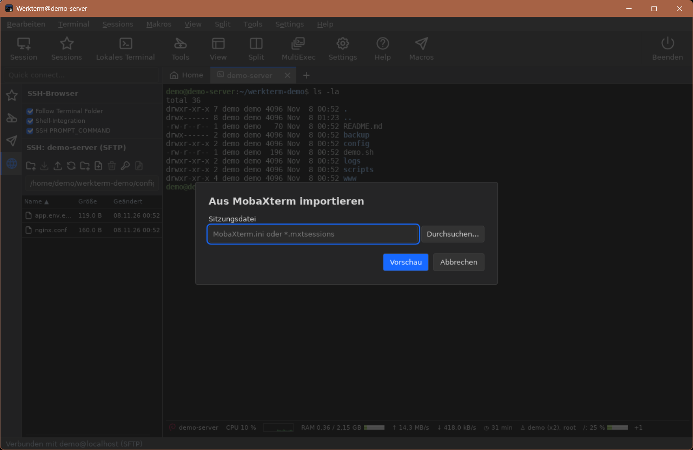

# Werkterm – SSH-Terminal mit SFTP-Browser und Editor für Linux und Windows

English version: [README.md](README.md)

Werkterm ist eine Desktop-Anwendung mit Tauri 2, Rust und React. Sie bietet lokale Terminals, SSH mit einem SFTP-Browser, der dem Terminal-Verzeichnis folgt, und einen integrierten Editor. Zielplattformen sind Linux (vorrangig) und Windows 10/11 x64.

> [!NOTE]
> Die aktuelle stabile Version steht auf der [GitHub-Releases-Seite](https://github.com/werklade/werkterm/releases). Rückmeldungen gehen an [Issues](https://github.com/werklade/werkterm/issues).

## Inhalt

- [Unabhängigkeit und Marken](#unabhängigkeit-und-marken)
- [Bildschirmansichten](#bildschirmansichten)
- [Funktionen](#funktionen)
- [Voraussetzungen](#voraussetzungen)
- [Installation](#installation)
  - [APT-Repository (Debian 13, Ubuntu 24.04 und neuer, amd64)](#apt-repository-debian-13-ubuntu-2404-und-neuer-amd64)
  - [AppImage, Windows-Installer und `.deb`-Datei](#appimage-windows-installer-und-deb-datei)
  - [Linux: Darstellungsprobleme / schwarzes Fenster](#linux-darstellungsprobleme--schwarzes-fenster)
- [Updates](#updates)
- [Datenordner](#datenordner)
- [Selbst bauen](#selbst-bauen)
- [Sicherheit](#sicherheit)
- [Technischer Überblick](#technischer-überblick)
- [Bekannte Einschränkungen](#bekannte-einschränkungen)
- [Ausblick](#ausblick)
- [Lizenz](#lizenz)
- [Herkunft](#herkunft)

## Unabhängigkeit und Marken

Werkterm ist ein unabhängiges Projekt ohne Verbindung zu Mobatek. Es wurde von Mobatek weder beauftragt noch geprüft oder unterstützt. MobaXterm ist eine Marke von Mobatek und wird ausschließlich zur Beschreibung des Imports von Sitzungen und Farben genannt. WindTerm, Debian und weitere Produktnamen sind Marken ihrer jeweiligen Inhaber. Die Software wird gemäß GPL ohne Gewährleistung bereitgestellt; siehe [LICENSE](LICENSE).

## Bildschirmansichten

| Terminal und SFTP | Editor |
| --- | --- |
|  |  |
| Sitzungen und Import | Berechtigungen und sudo |
|  |  |


## Funktionen

- **Terminals:** lokal Bash/konfigurierte Shell unter Linux; PowerShell, cmd und WSL unter Windows. Hardware-Übersicht unter Linux und Windows, Root-Terminal und Prozesse unter Linux; SSH-, Telnet- und serielle Sitzungen. Tabs, Split-Ansichten, MultiExec, Einstellungen für Schrift/Cursor/Scrollback/Farben. Kontextmenü: Kopieren, Alles kopieren, Leeren, Speichern als TXT/HTML/RTF. Bearbeitbare Einfüge-Rückfrage mit merkbarer Auswahl (pro Tab, pro gespeicherter Sitzung oder dauerhaft), Sitzungs-Logging und Schließen-Rückfrage. Ende-Menü: Return schließt, R verbindet im selben Tab erneut, S speichert die Ausgabe.
- **SSH:** eine Verbindung mit Shell- und SFTP-Kanälen, exec-Listing-Fallback, Hostkey-Prüfung gegen `known_hosts`, Agent-/Schlüssel- (einschließlich `.ppk`)/Passwortanmeldung, Keepalive und Jump-host-Ketten. SSH-Optionen je Sitzung (`-o Key=Value`, auch im Quick connect) für Schlüsselaustausch-, Hostkey-, Cipher- und MAC-Listen, Verbindungs-Timeout und Keepalive, etwa für ältere Server. Tunnel-Manager für `-L`, `-R` und SOCKS5 mit eigenen Hintergrundverbindungen, Autostart, Reconnect und Status. Monitoring-Leiste mit Tooltips für Host, CPU, RAM, Netzwerk, Laufzeit, Benutzer und Dateisysteme.
- **SFTP-Browser:** Follow Terminal Folder über OSC 7, Navigation, Sortierung, Dateitransfers mit Warteschlange, Fortschritt/Abbruch und Drag & Drop. Dateien/Ordner anlegen, rekursiv mit Bestätigung löschen, rekursives chmod mit getrennten Einstellungen für Dateien/Ordner, sudo-Modus und „Zum Vergleich merken“. Auch lokale und WSL-Verzeichnisse lassen sich anzeigen.
- **Sitzungen:** Ordner, Suche, Quick connect, zuletzt verwendete Sitzungen und Wiederherstellen letzter Tabs. Wählbarer Datenordner, etwa für mehrere Geräte über einen Cloud-Client. Sitzungsimport aus MobaXterm und WindTerm; Farbimport aus MobaXterm. Gespeicherte Passwörter liegen im System-Schlüsselbund. Verschlüsselte importierte Passwörter werden nicht wiederhergestellt.
- **Editor:** Syntaxfarben, Faltung, Suchen/Ersetzen und direkte Farbcode-Hinterlegung mit Kontrastwahl nach BT.601. CRLF-/LF-/CR-Erkennung und Umwandlung, Warnung bei gemischten Zeilenenden, UTF-8 mit/ohne BOM, Konfliktschutz und Speichern in-place unter Erhalt der Rechte.
- **Werkzeuge:** schreibgeschützter Dateivergleich (lokal/remote/gemischt), rekursiver Ordnervergleich mit optionalem Inhaltsvergleich, Makros mit Aufnahme, Text-/Warte-/Rückfrage-Schritten und Tastenkürzeln, SSH-Schlüssel erzeugen, offene lokale Ports, ASCII-Tabelle und Tux-Wanderer als Leerlauf-Animation. Die Linux-Seriell-Berechtigungshilfe ermittelt Gerätegruppen wie dialout/uucp und bietet nach Bestätigung einen Befehl im lokalen Terminal an.

## Voraussetzungen

Windows 10/11 x64 mit Microsoft Edge WebView2 (auf aktuellem Windows vorinstalliert; fehlt es, lädt der Installer es nach).

Linux x86_64 mit WebKitGTK 4.1 und GTK 3: Laufzeitpakete auf Debian-basierten Systemen heißen unter anderem `libwebkit2gtk-4.1-0` und `libgtk-3-0`. Empfohlen: `gnome-keyring` oder ein anderer Secret-Service-Dienst sowie `fonts-noto-color-emoji`. Als SSH-Server ist OpenSSH vorgesehen; SFTP wird empfohlen. Schreibaktionen/Transfers im Browser benötigen SFTP; der sudo-Modus zusätzlich sudo-Rechte und ein externes `sftp-server`-Programm.

## Installation

Die aktuelle stabile Version steht auf der [GitHub-Releases-Seite](https://github.com/werklade/werkterm/releases). Die Pakete setzen glibc 2.39 oder neuer voraus (Debian 13, Ubuntu 24.04 und Abkömmlinge); Debian 12 und Ubuntu 22.04 werden nicht unterstützt. Getestet unter Debian 13 (WebKitGTK 2.54). Der Produktname ist `Werkterm`, Paket-/Programmname ist `werkterm`. Der dokumentierte Linux-Build verwendet folgende Dateinamen mit dieser Groß-/Kleinschreibung. Alternativ lassen sich die Pakete wie unten beschrieben selbst bauen.

### APT-Repository (Debian 13, Ubuntu 24.04 und neuer, amd64)

Am schnellsten: [`install/werklade-apt-setup.sh`](install/werklade-apt-setup.sh) aus diesem Repository herunterladen (auf GitHub: Datei öffnen, dann „Download raw file“) und ausführen (Bash). Alternativ direkt abrufen: `curl -fsSLO https://raw.githubusercontent.com/werklade/werkterm/main/install/werklade-apt-setup.sh`. Das Skript prüft vor jeder Änderung den Fingerprint unten; `--dry-run` zeigt die Schritte nur an, `--remove` entfernt Quelle und Schlüssel wieder.

```bash
sudo bash werklade-apt-setup.sh --install werkterm
```

Von Hand:

Benötigt `curl` und `gpg` (`sudo apt install curl gpg`). Repository: `https://pkg.werklade.de/apt`, Suite `stable`, Komponente `main`, Architektur `amd64`. Der Repository-Schlüssel ist ed25519 mit diesem Fingerprint:

```
498E F081 BBC7 50A1 11DB  2EDA E0CD AE7D 9332 A76C
```

Bash, als normaler Benutzer (`sudo` wird je Befehl verwendet). Zuerst den Schlüssel herunterladen, noch nicht installieren, und den Fingerprint vergleichen:

```bash
curl -fsSL -o /tmp/werklade-archive-keyring.asc https://pkg.werklade.de/werklade-archive-keyring.asc
gpg --show-keys --with-fingerprint /tmp/werklade-archive-keyring.asc
```

Der angezeigte Fingerprint muss exakt mit dem Wert oben übereinstimmen. Weicht er ab: abbrechen und `/tmp/werklade-archive-keyring.asc` löschen. Erst danach Schlüssel installieren, Quelle anlegen und Paket installieren (ändert die Systemkonfiguration):

```bash
sudo install -d -m 0755 /etc/apt/keyrings
sudo install -m 0644 /tmp/werklade-archive-keyring.asc /etc/apt/keyrings/werklade-archive-keyring.asc
rm /tmp/werklade-archive-keyring.asc
sudo tee /etc/apt/sources.list.d/werklade.sources >/dev/null <<'EOF'
Types: deb
URIs: https://pkg.werklade.de/apt
Suites: stable
Components: main
Architectures: amd64
Signed-By: /etc/apt/keyrings/werklade-archive-keyring.asc
EOF
sudo apt update
sudo apt install werkterm
```

Prüfung: `werkterm` starten. Updates kommen mit `sudo apt update && sudo apt upgrade`. Deinstallation, Bash:

```bash
sudo apt remove werkterm
sudo rm /etc/apt/sources.list.d/werklade.sources /etc/apt/keyrings/werklade-archive-keyring.asc
sudo apt update
```

### AppImage, Windows-Installer und `.deb`-Datei

AppImage und Windows-Installer liegen unter `https://pkg.werklade.de/werkterm/downloads/<Version>/` (z. B. `1.0.0`) und auf der [GitHub-Releases-Seite](https://github.com/werklade/werkterm/releases) von `werklade/werkterm`. Die `.sig`-Dateien im Download-Ordner gehören zum eingebauten Updater und werden für die Installation nicht benötigt. Die `.deb`-Datei liegt nicht im Download-Ordner; sie gibt es über das APT-Repository oder den GitHub-Release.

Lokale `.deb` aus dem GitHub-Release, Bash (installiert ein Systempaket):

```bash
sudo apt install ./Werkterm_1.0.0_amd64.deb
```

Prüfung: `werkterm` starten. Deinstallation: `sudo apt remove werkterm`. Eine so installierte `.deb` ist nicht mit dem Repository verbunden; für Updates über APT den Abschnitt oben verwenden.

AppImage, Bash (`libfuse2` erforderlich; der Paketname kann je Distribution abweichen):

```bash
chmod +x ./Werkterm_1.0.0_amd64.AppImage
./Werkterm_1.0.0_amd64.AppImage
```

Zur Prüfung muss sich das Anwendungsfenster öffnen.

Windows: `Werkterm_1.0.0_x64-setup.exe` ausführen (installiert für den aktuellen Benutzer, ohne Adminrechte) oder `Werkterm_1.0.0_x64_en-US.msi` verteilen. Die Pakete sind nicht signiert; SmartScreen meldet beim ersten Start „Unbekannter Herausgeber“ – „Weitere Informationen“ → „Trotzdem ausführen“. Deinstallation über Einstellungen → Apps. Einstellungen und Sitzungen liegen unter `%APPDATA%\de.werklade.werkterm`. Zeigt die Taskleiste nach einem Update noch das alte Symbol, liegt das am Symbol-Cache von Windows: `ie4uinit.exe -show` ausführen oder ab- und wieder anmelden.

Downloads gegen `SHA256SUMS` prüfen (Linux: `sha256sum --check --ignore-missing SHA256SUMS`, Windows-PowerShell: `Get-FileHash <Datei>`). Die `SHA256SUMS` im Download-Ordner von pkg.werklade.de führt die `.deb` nicht auf; die im GitHub-Release schon.

### Linux: Darstellungsprobleme / schwarzes Fenster

Auf Systemen mit NVIDIA-Grafik kann das Fenster schwarz bleiben, sowohl mit dem proprietären Treiber als auch mit dem freien Treiber nouveau. Erkennt Werkterm eine solche Grafikkarte, setzt es beim Start `WEBKIT_DISABLE_DMABUF_RENDERER=1`. Beim proprietären Treiber kommt unter Wayland zusätzlich `__NV_DISABLE_EXPLICIT_SYNC=1` hinzu; bei nouveau wird nur `WEBKIT_DISABLE_DMABUF_RENDERER=1` gesetzt, auch unter Wayland. Das geschieht nicht, wenn eine dieser Variablen oder `WEBKIT_DISABLE_COMPOSITING_MODE` vom Nutzer gesetzt ist. Die Variablen werden nicht an lokale Terminals weitergegeben. Programme, die über die Desktop-Umgebung geöffnet werden (etwa der Dateimanager für den Log-Ordner), erben sie weiterhin. Auf Laptops mit zwei Grafikchips greift die Abhilfe auch, wenn Werkterm auf dem internen Chip läuft; abschalten mit `WERKTERM_NO_WEBKIT_WORKAROUND=1`.

| Variable | Wirkung |
| --- | --- |
| `WERKTERM_NO_WEBKIT_WORKAROUND=1` | Schaltet die automatische Umgehung ab. |
| `WERKTERM_WEBKIT_WORKAROUND=1` | Erzwingt die Umgehung, für betroffene Systeme ohne erkannte NVIDIA-Karte. |

Beispiel, Bash:

```bash
WERKTERM_WEBKIT_WORKAROUND=1 werkterm
```

Von einem Tester bestätigt: GeForce GTX 1060 mit nouveau unter X11 (.deb und AppImage 1.0.0) zeigt ohne `WEBKIT_DISABLE_DMABUF_RENDERER=1` ein schwarzes Fenster und funktioniert mit der Variable. Mit dem proprietären Treiber noch nicht bestätigt.

AppImage vor 1.0.0: Bleibt das Fenster trotzdem schwarz oder stürzt die Darstellung ab, fehlen dem AppImage GStreamer-Plugins. Abhilfe ist der Start mit `GST_PLUGIN_PATH_1_0=/usr/lib/x86_64-linux-gnu/gstreamer-1.0` (Debian/Ubuntu-Pfad; andere Distributionen verwenden andere Pfade). Ab 1.0.0 bringt das AppImage die Plugins selbst mit; die Variable dann entfernen, denn System-Plugins mit dem mitgelieferten GStreamer zu mischen kann abstürzen.

```bash
GST_PLUGIN_PATH_1_0=/usr/lib/x86_64-linux-gnu/gstreamer-1.0 ./Werkterm_0.1.8_amd64.AppImage
```

## Updates

Werkterm sucht nur auf Anforderung nach Updates: **Hilfe > Nach Updates suchen…**. Eine Prüfung beim Start ist optional (Einstellungen > Updates, standardmäßig aus). Kontaktiert wird ausschließlich `pkg.werklade.de`; es werden keine Daten übertragen.

- AppImage und die Windows-Installer (NSIS, MSI) laden das signierte Update und installieren es; Werkterm startet danach neu. Die Signatur wird gegen einen in Werkterm eingebauten Schlüssel geprüft.
- Eine `.deb`-Installation wird über das Werklade-APT-Repository aktualisiert (`sudo apt update && sudo apt upgrade`).

Testversionen: AppImage- und Windows-Installationen wählen den Update-Kanal unter Einstellungen > Updates > Update-Kanal (Stable oder Test, je Gerät gespeichert, Standard Stable). Testversionen können unfertig sein. Der Testkanal bietet die jeweils neuere Version an, die letzte Testversion oder die letzte stabile Version. Zurück auf Stable bietet Werkterm die letzte stabile Version an, auch wenn sie älter als eine installierte Testversion ist; diesen Downgrade muss man im Update-Dialog ausdrücklich bestätigen. Die Umgebungsvariable `WERKTERM_UPDATE_CHANNEL=test` bzw. `=stable` hat Vorrang vor der Einstellung (Bash: `WERKTERM_UPDATE_CHANNEL=test ./Werkterm_<version>_amd64.AppImage`; PowerShell: `$env:WERKTERM_UPDATE_CHANNEL='test'; & "$env:LOCALAPPDATA\Werkterm\werkterm.exe"`). Das APT-Repository hat noch keinen Testbereich ([#15](https://github.com/werklade/werkterm/issues/15)).

## Datenordner

Beim ersten Start fragt Werkterm nach dem Datenordner: Standardordner oder ein eigener Ordner, z. B. ein von einem Cloud-Client zwischen mehreren Geräten synchronisierter. Später änderbar unter Einstellungen > Datenordner. Werkterm startet beim Wechsel neu; laufende Tunnel werden gestoppt, offene Verbindungen nach Rückfrage getrennt. Unter Windows ist der Standardordner `%APPDATA%\de.werklade.werkterm`.

- **Im Datenordner:** `sessions.json`, `tunnels.json`, `macros.json`, `settings.json`, `designs/`, `icon-sets/`.
- **Lokal pro Gerät:** Passwörter (OS-Schlüsselbund), Zuletzt-verwendet-Liste, zuletzt offene Tabs, Editor-Cache, Logs und der Log-Ordner-Pfad, Fenster- und Spaltenbreiten.
- **Vorhandene Daten:** Enthält der gewählte Ordner schon Werkterm-Daten, werden sie verwendet. Sonst lassen sich die bisherigen Daten dorthin kopieren; nichts wird überschrieben, die Quelle bleibt unverändert.
- **Mehrere Geräte:** Änderungen von außen werden beim Wechsel zurück ins Fenster erkannt und neu geladen. Einstellungen werden vor dem Speichern gegen die zuletzt gelesene Fassung geprüft; bei Abweichung werden nur die eigenen Änderungen über die neue Fassung gelegt. Zu gleichzeitigen Änderungen siehe „Bekannte Einschränkungen“.
- **Ordner nicht erreichbar:** z. B. ein nicht eingehängtes Cloud-Laufwerk. Werkterm zeigt einen Dialog (Erneut versuchen / Anderen Ordner wählen / Standardordner verwenden) und schreibt bis dahin nichts; es gibt keinen stillen Rückfall.

Die Dateien sind nicht verschlüsselt und enthalten Hostnamen und Benutzernamen, aber keine Passwörter. Umgesetzt und automatisch getestet; im laufenden Programm noch nicht von Hand geprüft.

## Selbst bauen

Benötigt werden Linux x86_64, Rust stable mit Unterstützung für Edition 2024, Node.js mit npm und die [offiziellen Tauri-Linux-Abhängigkeiten](https://v2.tauri.app/start/prerequisites/). Windows-Pakete werden unter Windows gebaut. Das Frontend verwendet TypeScript `~6.0.3`; Manifeste und Lockdateien legen Abhängigkeiten fest. Das Projekt nennt keine minimale Node.js-Version.

Im Projektverzeichnis, Bash:

```bash
npm ci
npm run tauri dev
```

Für Linux-Pakete, Bash:

```bash
npm run tauri build
```

Ausgabe: `src-tauri/target/release/bundle/{deb,appimage}` unter Linux, `src-tauri/target/release/bundle/{nsis,msi}` unter Windows (laufende Dev-Instanz vorher beenden). Zur Prüfung die erzeugten Dateien kontrollieren und installiertes Paket oder AppImage starten.

Nach dem Release-Build die Programmdatei auf Benutzerpfade des Build-Rechners prüfen (Bash oder PowerShell, Projektverzeichnis):

```bash
npm run check-paths
```

Ohne Argumente wird `src-tauri/target/release/werkterm` geprüft (unter Windows `werkterm.exe`); andere Dateien oder Verzeichnisse, etwa ein entpacktes AppImage, lassen sich nach `--` angeben. Pakete (`.deb`, AppImage, `.msi`) sind komprimierte Container und werden nicht direkt durchsucht. Erfolg: Ausgabe `check-paths: 0 user paths in <n> file(s)`, Exit-Code 0; bei Funden ist der Exit-Code 1.

Tests, Bash:

```bash
cargo test --manifest-path src-tauri/Cargo.toml
npm test
```

Beide Befehle sollen erfolgreich enden. Der optionale Live-SSH-Test wird standardmäßig übersprungen und benötigt einen ausdrücklich konfigurierten Testserver.

## Sicherheit

Gespeicherte Anmeldepasswörter liegen ausschließlich im System-Schlüsselbund, nie in Konfigurationsdateien oder Diagnoseprotokollen der Anwendung. Anmeldedialoge halten Geheimnisse während ihrer Verwendung im Speicher; `sessions.json` enthält Einstellungen ohne gespeicherte Passwörter. Ein sudo-Passwort wird ausschließlich an sudo gesendet und nie gespeichert.

Es gibt keine Telemetrie oder automatische Dienstsuche. Verbindungen dienen den vom Nutzer konfigurierten SSH-Zielen/Jump hosts, Telnet-Zielen und Tunnel-Listenern/weitergeleiteten Zielen; Autostart-Tunnel können sich beim Start verbinden. Telnet ist unverschlüsselt.

Hostkeys werden gegen `known_hosts` geprüft: Unbekannte Schlüssel benötigen eine Bestätigung mit SHA256-Fingerprint; geänderte Schlüssel führen zum Abbruch. Sitzungsprotokolle/Exporte enthalten angezeigten Terminaltext; Makros speichern aufgezeichneten Text im Klartext. Geheimnisse deshalb weder aufzeichnen noch in diese Ausgaben schreiben lassen. Die Makrowiedergabe umgeht bewusst die Einfüge-Rückfrage.

## Technischer Überblick

Das Rust-Backend verwendet Tauri 2, `russh`, `russh-sftp`, `portable-pty`, `keyring` und `serialport`. Commands bearbeiten Anfragen; Tauri-Channels übertragen Terminalbytes und Transferfortschritt. React nutzt xterm.js und CodeMirror 6 einschließlich `@codemirror/merge` für Vergleiche. Siehe [Architektur](docs/architektur.md).

## Bekannte Einschränkungen

- Kein Ordner-Upload/-Download; der rekursive Ordnervergleich ist eine eigene Funktion.
- Die automatische entfernte OSC-7-Einrichtung unterstützt nur Bash; andere Shells benötigen eigene Integration. Das Echo des eingespielten Befehls wird nach Ausführung gelöscht.
- Der Remote-Konfliktschutz im Editor nutzt Dateigröße und sekundengenaue Änderungszeit: Gleich große Änderungen innerhalb einer Sekunde können unbemerkt bleiben. Lokale Dateien werden zusätzlich anhand ihrer Identität und genauerer Zeitstempel geprüft.
- Der Editor unterstützt ausschließlich UTF-8-Text bis 10 MiB. Gemischte Zeilenenden müssen vor dem Speichern ausdrücklich vereinheitlicht werden.
- Ein Host, für den `known_hosts` nur einen anderen Schlüsseltyp enthält, wird als geändert abgelehnt. Den Eintrag vor einem Ersetzen prüfen.
- Datenordner: Bearbeiten zwei Geräte gleichzeitig dieselbe Sitzung, gewinnt die zuletzt gespeicherte Fassung, oder der Sync-Client legt eine Konfliktkopie an. Designs werden bei externen Änderungen nicht neu geladen.
- Exec-Listing benötigt GNU-kompatible Werkzeuge und bietet keine SFTP-Schreibaktionen/Transfers.
- Secret Service oder Sitzungs-D-Bus können insbesondere unter WSL fehlen; gespeicherte Passwortoperationen melden dann einen Fehler.
- Windows-/WSL-Entwicklung: WSL-Tabs nutzen die Standarddistribution; PowerShell-UNC-Verzeichnislisting ist nicht bestätigt.
- AppImage vor 1.0.0 ohne GStreamer-Plugins: siehe „Linux: Darstellungsprobleme / schwarzes Fenster“.
- Die Linux-Seriell-Berechtigungshilfe benötigt noch einen Gerätetest in der paketierten Anwendung. STATUS.md nennt außerdem die SSH-Schließen-Rückfrage auf Fensterebene als manuell zu prüfen.

## Ausblick

Geplante Arbeiten stehen als GitHub-Issues in den [Meilensteinen](https://github.com/werklade/werkterm/milestones) (zum Beispiel [1.1.0](https://github.com/werklade/werkterm/milestone/1)), mit den Labels `in progress` und `testing`. Fertige, noch nicht veröffentlichte Änderungen stehen unter „Unreleased“ in der [CHANGELOG.md](CHANGELOG.md). Funktionswünsche: [neues Issue](https://github.com/werklade/werkterm/issues/new/choose).

Zurückgestellt: Tabs ablösen, Popup-Konsole, Mosh/RDP/VNC.

Nicht geplant: Master-Passwort (stattdessen System-Schlüsselbund), mitgeliefertes X11/Cygwin, Netzwerk-/Port-Scanner, Paketmitschnitt und vorerst Wake on LAN.

## Lizenz

GPL-3.0-or-later; siehe [LICENSE](LICENSE).

Drittanbieter-Grafiken: Tabler Icons (MIT; [Lizenz](src/assets/icons/LICENSE-tabler-icons.txt)); Debian Open Use Logo, Copyright Software in the Public Interest, Inc., unter LGPL-3.0-or-later oder CC BY-SA 3.0. Debian ist eine eingetragene Marke von SPI. Werkterm steht in keiner Verbindung zum Debian-Projekt; das Logo kennzeichnet ausschließlich Debian-Hosts. Siehe [Grafiknachweise](src/assets/icons/README.md).

Wichtige Bibliotheken sind Tauri, russh, russh-sftp, xterm.js, CodeMirror (einschließlich `@codemirror/merge`), portable-pty, keyring und serialport. Für diese Komponenten gelten ihre jeweiligen Lizenzen.

## Herkunft

Das Projekt wurde mit Unterstützung von Claude Code entwickelt. Für Teilaufgaben wurden außerdem OpenAI Codex CLI, Google Antigravity und lokales Ollama verwendet.
