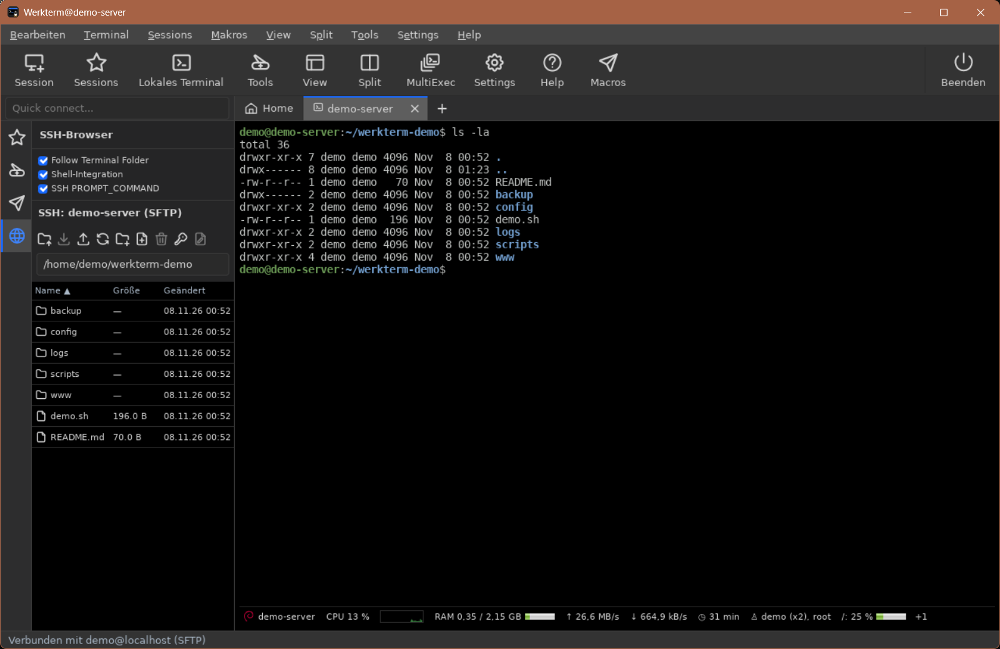
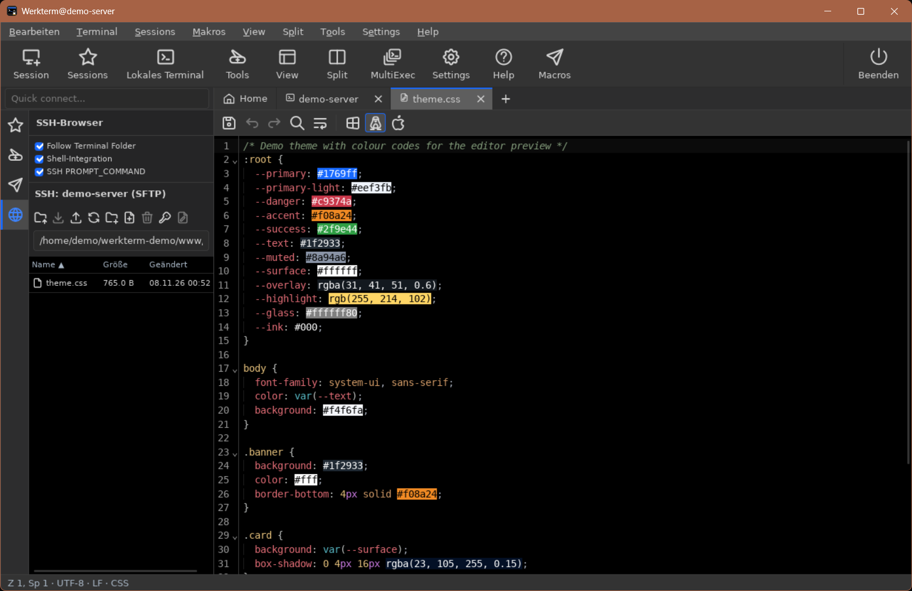
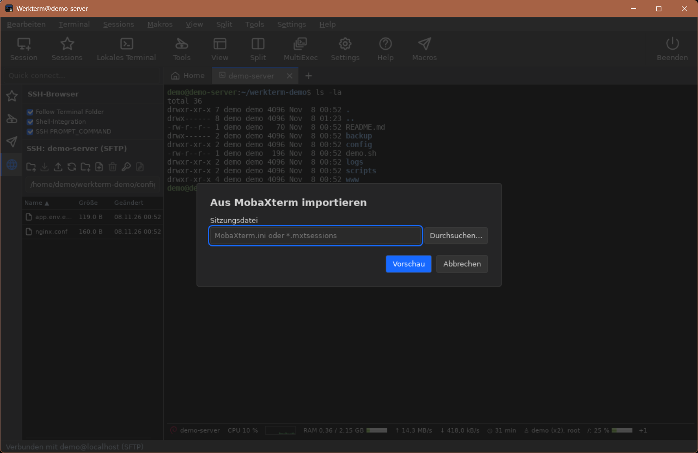
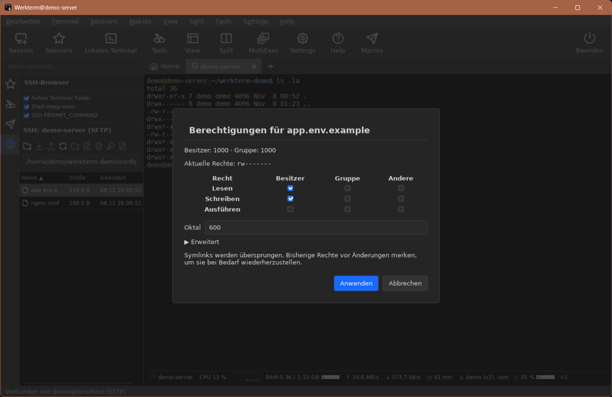

# Werkterm – SSH terminal with SFTP browser and editor for Linux and Windows

Deutsche Fassung: [README.de.md](README.de.md)

Werkterm is a desktop application built with Tauri 2, Rust and React. It provides local terminals, SSH with an SFTP browser that follows the terminal directory, and an integrated editor. It targets Linux first and also runs on Windows 10/11 x64.

> [!NOTE]
> The current stable release is listed on the [GitHub releases page](https://github.com/werklade/werkterm/releases). Feedback goes to [Issues](https://github.com/werklade/werkterm/issues).

## Contents

- [Independence and trademarks](#independence-and-trademarks)
- [Screens](#screens)
- [Features](#features)
- [Requirements](#requirements)
- [Installing](#installing)
  - [APT repository (Debian 13, Ubuntu 24.04 and newer, amd64)](#apt-repository-debian-13-ubuntu-2404-and-newer-amd64)
  - [AppImage, Windows installers and `.deb` file](#appimage-windows-installers-and-deb-file)
  - [Linux: display problems / black window](#linux-display-problems--black-window)
- [Updates](#updates)
- [Data folder](#data-folder)
- [Building](#building)
- [Security](#security)
- [Technical overview](#technical-overview)
- [Known limitations](#known-limitations)
- [Roadmap](#roadmap)
- [License](#license)
- [Origin](#origin)

## Independence and trademarks

Werkterm is an independent project with no affiliation to Mobatek. It has not been commissioned, reviewed or supported by Mobatek. MobaXterm is a trademark of Mobatek and is mentioned only to describe importing sessions and colors. WindTerm, Debian and other product names are trademarks of their respective owners. The software is supplied without warranty under the GPL; see [LICENSE](LICENSE).

## Screens

| Terminal and SFTP | Editor |
| --- | --- |
|  |  |
| Sessions and import | Permissions and sudo |
|  |  |


## Features

- **Terminals:** local Bash/configured shell on Linux; PowerShell, cmd and WSL on Windows. Hardware overview on Linux and Windows, root terminal and processes on Linux; SSH, Telnet and serial sessions. Tabs, split views, MultiExec, font/cursor/scrollback/color settings. Context menu: copy, copy all, clear, save as TXT/HTML/RTF. Editable paste confirmation that can remember the choice per tab, per saved session or permanently, session logging and close confirmation. Session-end menu: Return closes, R reconnects in the same tab, S saves output.
- **SSH:** one connection with shell and SFTP channels, exec listing fallback, host-key verification against `known_hosts`, agent/key (including `.ppk`)/password authentication, keepalive and jump-host chains. Per-session SSH options (`-o Key=Value`, also in quick connect) for key exchange, host key, cipher and MAC lists, connect timeout and keepalive, e.g. to reach older servers. Tunnel manager for `-L`, `-R` and SOCKS5, with separate background connections, autostart, reconnect and status. Monitoring bar with tooltips for host, CPU, RAM, network, uptime, users and filesystems.
- **SFTP browser:** Follow Terminal Folder via OSC 7, navigation, sorting, queued file and folder transfers with progress/cancellation and drag and drop. Create files/directories, confirmed recursive deletion, recursive chmod with separate file/directory settings, sudo mode and “remember for comparison”. Local and WSL directory browsing is also available.
- **Sessions:** folders (move by mouse or keyboard, rename, create empty, with undo), search, quick connect, recent sessions and last-tab restoration. Selectable data folder, for example for several devices through a cloud client. Session import from MobaXterm and WindTerm; color import from MobaXterm. Saved passwords use the system keyring. Encrypted imported passwords are not recovered.
- **Editor:** syntax highlighting, folding, search/replace and live color-code backgrounds with BT.601 contrast selection. CRLF/LF/CR detection and conversion, mixed-line-ending warning, UTF-8 with/without BOM, conflict checks and in-place saving with permissions preserved.
- **Tools:** read-only file comparison (local/remote/mixed), recursive folder comparison with optional content comparison, macros with recording, text/wait/prompt steps and shortcuts, SSH key generation, open local ports, ASCII table and Tux wanderer idle animation. Linux serial-permission assistance identifies device groups such as dialout/uucp and offers a confirmed command in a local terminal.

## Requirements

Windows 10/11 x64 with Microsoft Edge WebView2 (preinstalled on current Windows; the installer downloads it if missing).

Linux x86_64 with WebKitGTK 4.1 and GTK 3: Debian-family runtime packages include `libwebkit2gtk-4.1-0` and `libgtk-3-0`. Recommended: `gnome-keyring` or another Secret Service provider, and `fonts-noto-color-emoji`. OpenSSH is the intended SSH server; SFTP is recommended. Browser writes/transfers require SFTP; sudo mode also needs sudo permission and an external `sftp-server` executable.

## Installing

The current stable release is listed on the [GitHub releases page](https://github.com/werklade/werkterm/releases). The packages require glibc 2.39 or newer (Debian 13, Ubuntu 24.04 and derivatives); Debian 12 and Ubuntu 22.04 are not supported. Tested on Debian 13 (WebKitGTK 2.54). The product name is `Werkterm`, the package/executable name is `werkterm`. The recorded Linux build uses these case-sensitive artifact names. Alternatively build the packages as described below.

### APT repository (Debian 13, Ubuntu 24.04 and newer, amd64)

Quickest way: download [`install/werklade-apt-setup.sh`](install/werklade-apt-setup.sh) from this repository (on GitHub: open the file, then "Download raw file") and run it (Bash). Alternatively fetch it directly: `curl -fsSLO https://raw.githubusercontent.com/werklade/werkterm/main/install/werklade-apt-setup.sh`. It checks the key fingerprint below before changing anything; `--dry-run` only shows the steps, `--remove` removes the source and key again.

```bash
sudo bash werklade-apt-setup.sh --install werkterm
```

Test builds: add `--test` (also combinable with `--install`) to write `Suites: stable test`, e.g. `sudo bash werklade-apt-setup.sh --test --install werkterm`. The way back: run the script again without `--test`; if a test build is installed, it prints the command `sudo apt install werkterm=<version>` for the downgrade and does not run it.

Manual setup:

Requires `curl` and `gpg` (`sudo apt install curl gpg`). Repository: `https://pkg.werklade.de/apt`, suite `stable`, component `main`, architecture `amd64`. The repository key is ed25519 with this fingerprint:

```
498E F081 BBC7 50A1 11DB  2EDA E0CD AE7D 9332 A76C
```

Bash, as a normal user (`sudo` is used per command). First download the key without installing it and compare the fingerprint:

```bash
curl -fsSL -o /tmp/werklade-archive-keyring.asc https://pkg.werklade.de/werklade-archive-keyring.asc
gpg --show-keys --with-fingerprint /tmp/werklade-archive-keyring.asc
```

The displayed fingerprint must match the value above exactly. If it differs, stop and delete `/tmp/werklade-archive-keyring.asc`. Only then install the key, add the source and install the package (changes system configuration):

```bash
sudo install -d -m 0755 /etc/apt/keyrings
sudo install -m 0644 /tmp/werklade-archive-keyring.asc /etc/apt/keyrings/werklade-archive-keyring.asc
rm /tmp/werklade-archive-keyring.asc
sudo tee /etc/apt/sources.list.d/werklade.sources >/dev/null <<'EOF'
Types: deb
URIs: https://pkg.werklade.de/apt
Suites: stable
Components: main
Architectures: amd64
Signed-By: /etc/apt/keyrings/werklade-archive-keyring.asc
EOF
sudo apt update
sudo apt install werkterm
```

Verify by starting `werkterm`. Updates arrive with `sudo apt update && sudo apt upgrade`. To uninstall (Bash):

```bash
sudo apt remove werkterm
sudo rm /etc/apt/sources.list.d/werklade.sources /etc/apt/keyrings/werklade-archive-keyring.asc
sudo apt update
```

### AppImage, Windows installers and `.deb` file

AppImage and Windows installers are available at `https://pkg.werklade.de/werkterm/downloads/<version>/` (for example `1.0.0`) and on the [GitHub releases page](https://github.com/werklade/werkterm/releases) of `werklade/werkterm`. The `.sig` files in the download folder belong to the built-in updater and are not needed for installation. The `.deb` is not in the download folder; it is available through the APT repository or the GitHub release.

Local `.deb` from the GitHub release, Bash (installs a system package):

```bash
sudo apt install ./Werkterm_1.0.0_amd64.deb
```

Verify by starting `werkterm`. To uninstall: `sudo apt remove werkterm`. A `.deb` installed this way is not connected to the repository; for updates through APT use the section above.

AppImage, Bash (`libfuse2` required; its package name can vary by distribution):

```bash
chmod +x ./Werkterm_1.0.0_amd64.AppImage
./Werkterm_1.0.0_amd64.AppImage
```

Verify that the application window opens.

Windows: run `Werkterm_1.0.0_x64-setup.exe` (installs for the current user, no admin rights) or deploy `Werkterm_1.0.0_x64_en-US.msi`. The packages are not code-signed, so SmartScreen shows "Unknown publisher" on first start; choose "More info" → "Run anyway". Uninstall via Settings → Apps. Settings and sessions are stored in `%APPDATA%\de.werklade.werkterm`. If the taskbar still shows the old icon after an update, that is the Windows icon cache: run `ie4uinit.exe -show` or sign out and back in.

Check downloads against `SHA256SUMS` (Linux: `sha256sum --check --ignore-missing SHA256SUMS`, Windows PowerShell: `Get-FileHash <file>`). The `SHA256SUMS` in the pkg.werklade.de download folder does not list the `.deb`; the one in the GitHub release does.

### Linux: display problems / black window

On systems with NVIDIA graphics, the window can stay black, with the proprietary driver as well as with the open-source driver nouveau. If it detects such a graphics card, Werkterm sets `WEBKIT_DISABLE_DMABUF_RENDERER=1` at startup. With the proprietary driver it also sets `__NV_DISABLE_EXPLICIT_SYNC=1` under Wayland; with nouveau it sets only `WEBKIT_DISABLE_DMABUF_RENDERER=1`, under Wayland too. This does not happen if you have set one of these variables or `WEBKIT_DISABLE_COMPOSITING_MODE` yourself. The variables are not passed on to local terminals. Programs opened through the desktop (for example the file manager for the log folder) still inherit them. On laptops with two graphics chips the workaround also applies when Werkterm runs on the integrated chip; turn it off with `WERKTERM_NO_WEBKIT_WORKAROUND=1`.

| Variable | Effect |
| --- | --- |
| `WERKTERM_NO_WEBKIT_WORKAROUND=1` | Disables the automatic workaround. |
| `WERKTERM_WEBKIT_WORKAROUND=1` | Forces the workaround, for affected systems without a detected NVIDIA card. |

Example, Bash:

```bash
WERKTERM_WEBKIT_WORKAROUND=1 werkterm
```

Confirmed by a tester: GeForce GTX 1060 with nouveau under X11 (.deb and AppImage 1.0.0) shows a black window without `WEBKIT_DISABLE_DMABUF_RENDERER=1` and works with it. Not yet confirmed with the proprietary driver.

AppImage before 1.0.0: if the window stays black or rendering crashes even so, the AppImage lacks GStreamer plugins. Starting with `GST_PLUGIN_PATH_1_0=/usr/lib/x86_64-linux-gnu/gstreamer-1.0` (Debian/Ubuntu path; other distributions use different paths) helps. From 1.0.0 the AppImage ships the plugins itself; remove the variable then, as mixing system plugins with the bundled GStreamer can crash.

```bash
GST_PLUGIN_PATH_1_0=/usr/lib/x86_64-linux-gnu/gstreamer-1.0 ./Werkterm_0.1.8_amd64.AppImage
```

## Updates

Werkterm checks for updates only when you ask for it: **Hilfe > Nach Updates suchen…**. A check at startup is optional (Settings > Updates, off by default). The only host contacted is `pkg.werklade.de`; no data is transmitted.

- AppImage and the Windows installers (NSIS, MSI) download the signed update and install it; Werkterm restarts afterwards. The signature is verified against a key built into Werkterm.
- A `.deb` installation is updated through the Werklade APT repository (`sudo apt update && sudo apt upgrade`).

Test builds: AppImage and Windows installations choose the update channel under Settings > Updates > Update channel (Stable or Test, stored per device, Stable by default). Test builds may be unfinished. The test channel offers whichever is newer, the latest test build or the latest stable release. Back on Stable, Werkterm offers the latest stable release even if it is older than an installed test build; installing that downgrade needs an explicit confirmation in the update dialog. The environment variable `WERKTERM_UPDATE_CHANNEL=test` or `=stable` overrides the setting (Bash: `WERKTERM_UPDATE_CHANNEL=test ./Werkterm_<version>_amd64.AppImage`; PowerShell: `$env:WERKTERM_UPDATE_CHANNEL='test'; & "$env:LOCALAPPDATA\Werkterm\werkterm.exe"`). `.deb` installations get test builds from the APT distribution `test`: run `sudo bash werklade-apt-setup.sh --test` (or set the line `Suites: stable test` in `/etc/apt/sources.list.d/werklade.sources` by hand), then run `sudo apt update && sudo apt install werkterm`. With the update channel on Test, the update dialog shows these commands to copy; back on Stable it shows the commands to remove `test` again and install the stable version with `sudo apt install werkterm=<version>`. Werkterm never runs these commands itself.

## Data folder

On first start Werkterm asks for the data folder: the default folder or a folder of your own, for example one that a cloud client synchronizes between several devices. Change it later under Settings > Data folder. Werkterm restarts on change; running tunnels are stopped and open connections are closed after confirmation. On Windows the default folder is `%APPDATA%\de.werklade.werkterm`.

- **In the data folder:** `sessions.json`, `tunnels.json`, `macros.json`, `settings.json`, `designs/`, `icon-sets/`.
- **Stays local per device:** passwords (OS keyring), recent list, last open tabs, editor cache, logs and the log folder path, window and column widths.
- **Existing data:** if the chosen folder already contains Werkterm data, it is used. Otherwise the existing data can be copied there; nothing is overwritten and the source stays unchanged.
- **Several devices:** changes from outside are detected when the window regains focus and reloaded. Before saving, settings are compared with the last version read; if they differ, only your own changes are applied on top of the new version. See "Known limitations" for simultaneous edits.
- **Unreachable folder:** for example a cloud drive that is not mounted. Werkterm shows a dialog (Try again / Choose another folder / Use default folder) and writes nothing until then; there is no silent fallback.

The files are not encrypted and contain host names and user names, but no passwords. Implemented and covered by automated tests; not yet verified by hand in the running program.

## Building

Use Linux x86_64, Rust stable with Edition 2024 support, Node.js with npm and the [official Tauri Linux prerequisites](https://v2.tauri.app/start/prerequisites/). Windows packages are built on Windows. The frontend uses TypeScript `~6.0.3`; manifests and lockfiles define dependencies. The project declares no minimum Node.js version.

From the project root, Bash:

```bash
npm ci
npm run tauri dev
```

For Linux packages, Bash:

```bash
npm run tauri build
```

Output: `src-tauri/target/release/bundle/{deb,appimage}` on Linux, `src-tauri/target/release/bundle/{nsis,msi}` on Windows (stop a running dev instance first). Verify the generated artifacts and launch the installed package or AppImage.

After the release build, check the binaries for user paths of the build machine (Bash or PowerShell, project root):

```bash
npm run check-paths
```

Without arguments it checks `src-tauri/target/release/werkterm` (`werkterm.exe` on Windows); other files or directories, for example an extracted AppImage, can be passed after `--`. Packages (`.deb`, AppImage, `.msi`) are compressed containers and are not scanned directly. Success: output `check-paths: 0 user paths in <n> file(s)`, exit code 0; with findings the exit code is 1.

Tests, Bash:

```bash
cargo test --manifest-path src-tauri/Cargo.toml
npm test
```

Both commands should exit successfully. The optional live SSH test is ignored by default and requires an explicitly configured test server.

## Security

Saved authentication passwords are stored only in the system keyring, never in configuration files or application diagnostic logs. Authentication prompts hold secrets in memory while needed; `sessions.json` contains settings without stored passwords. A sudo password is sent only to sudo and never saved.

There is no telemetry or automatic service discovery. Connections serve user-configured SSH targets/jump hosts, Telnet targets and tunnel listeners/forwarded destinations; autostart tunnels can connect at startup. Telnet is unencrypted.

Host keys are checked against `known_hosts`: unknown keys require confirmation with a SHA256 fingerprint; changed keys abort the connection. Session logs/exports contain displayed terminal text; macros store recorded text in plaintext. Do not record or echo secrets into these features. Macro playback intentionally bypasses paste confirmation.

## Technical overview

The Rust backend uses Tauri 2, `russh`, `russh-sftp`, `portable-pty`, `keyring` and `serialport`. Commands handle requests; Tauri channels stream terminal bytes and transfer progress. React uses xterm.js and CodeMirror 6, including `@codemirror/merge` for comparison. See [architecture (German)](docs/architektur.md).

## Known limitations

- Under the experimental Cinnamon Wayland session (Linux Mint) files dragged from the file manager do not reach Werkterm; the desktop delivers no drop events. Use the upload button or the regular (X11) Cinnamon session.
- Folder transfers skip symbolic links inside the folder and are limited to 10,000 entries and 32 levels. Every file is a separate transfer, so many small files take noticeably longer than one large file. A folder replaced by a symbolic link on the server while the transfer runs is not detected. Downloads to Windows skip names Windows cannot store (for example `a:b`, `nul.txt`, a trailing dot) and reject folders whose names differ only in case.
- Automatic remote OSC 7 setup supports Bash only; other shells need their own integration. The injected command's echo is cleared after execution.
- Remote editor conflict checks use file size and second-resolution modification time: same-size changes within one second can go undetected. Local files also have identity and finer timestamp checks.
- The editor supports UTF-8 text only, up to 10 MiB. Mixed line endings require explicit normalization before saving.
- A host with only another key type in `known_hosts` is rejected as changed. Review the entry before replacing it.
- Data folder: if two devices edit the same session at the same time, the last saved version wins or the sync client creates a conflict copy. Designs are not reloaded on external changes.
- Exec listing requires GNU-compatible tools and does not provide SFTP writes/transfers.
- Secret Service or session D-Bus may be unavailable, especially under WSL; saved-password operations then report an error.
- Windows/WSL development: WSL tabs use the default distribution; PowerShell UNC directory listing is not confirmed.
- AppImage before 1.0.0 without GStreamer plugins: see "Linux: display problems / black window".
- Linux serial-permission assistance still needs a real-device test in the packaged application. STATUS.md also lists window-level SSH close confirmation as awaiting manual verification.

## Roadmap

Planned work is tracked as GitHub issues: see the [milestones](https://github.com/werklade/werkterm/milestones) (for example [1.1.0](https://github.com/werklade/werkterm/milestone/1)) and the labels `in progress` and `testing`. Finished but unreleased changes are listed under "Unreleased" in [CHANGELOG.md](CHANGELOG.md). Feature requests: [new issue](https://github.com/werklade/werkterm/issues/new/choose).

Deferred: detached tabs, popup console, Mosh/RDP/VNC.

Not planned: master password (system keyring is used), bundled X11/Cygwin, network/port scanner, packet capture and, for now, Wake on LAN.

## License

GPL-3.0-or-later; see [LICENSE](LICENSE).

Third-party graphics: Tabler Icons (MIT; [license](src/assets/icons/LICENSE-tabler-icons.txt)); Debian Open Use Logo, copyright Software in the Public Interest, Inc., under LGPL-3.0-or-later or CC BY-SA 3.0. Debian is a registered trademark of SPI. Werkterm is not affiliated with the Debian project; the logo only identifies Debian hosts. See [icon attribution](src/assets/icons/README.md).

Important libraries include Tauri, russh, russh-sftp, xterm.js, CodeMirror (including `@codemirror/merge`), portable-pty, keyring and serialport. Their respective licenses apply to those components.

## Origin

The project was developed with the assistance of Claude Code. OpenAI Codex CLI, Google Antigravity and local Ollama were also used for individual tasks.
